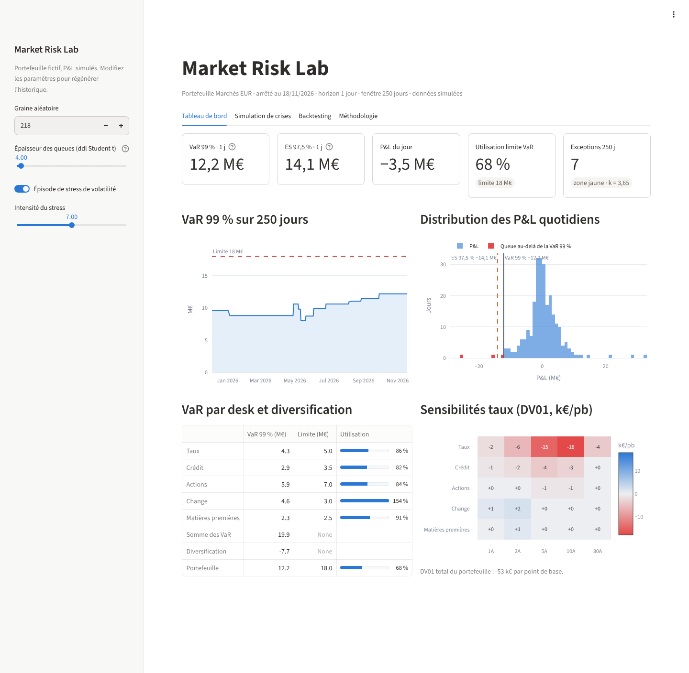
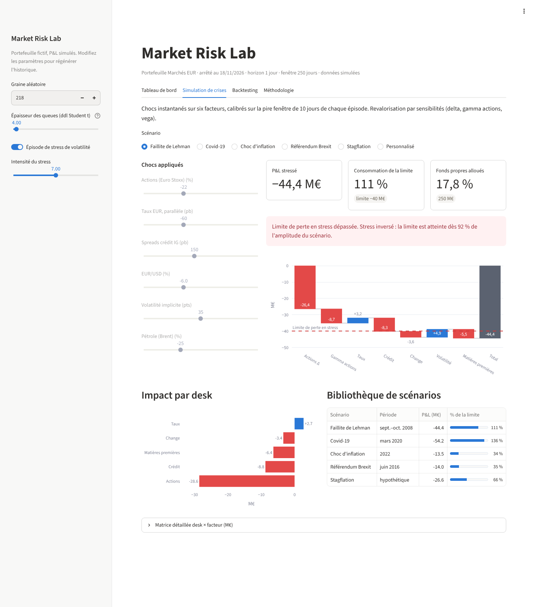
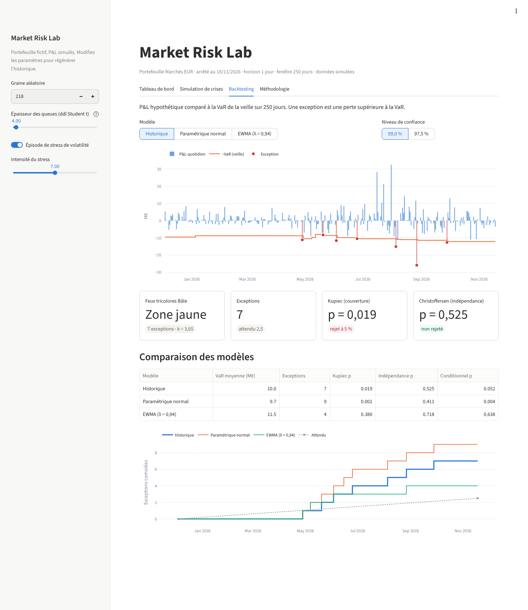

# Market Risk Lab

**Laboratoire interactif de mesure du risque de marché : VaR, Expected Shortfall, simulation de crises et backtesting réglementaire.**


[](https://github.com/eric-dadie/gdp-dashboard/actions/workflows/tests.yml)


L'application reproduit le poste de travail d'un analyste risque de marché sur un portefeuille de négociation fictif de cinq desks (taux, crédit, actions, change, matières premières). Elle couvre la chaîne complète :

1. **Mesurer** le risque du jour (VaR, ES, consommation des limites, diversification, sensibilités).
2. **Stresser** le portefeuille sur des crises historiques ou des chocs personnalisés, avec stress inversé.
3. **Valider** le modèle par backtesting (Kupiec, Christoffersen, feux tricolores Bâle, seuils FRTB).



---

## Fonctionnalités

### 1. Tableau de bord VaR
- VaR historique 99 % à 1 jour et **Expected Shortfall 97,5 %** (convention FRTB) sur 250 jours
- Historique de la VaR face à la limite du portefeuille
- Distribution des P&L avec la queue de perte mise en évidence
- VaR autonome par desk, consommation des limites et **effet de diversification**
- Carte de chaleur des **DV01** par desk et par point de courbe

### 2. Simulation de crises
- Bibliothèque de scénarios : **Lehman 2008, Covid-19 2020, choc d'inflation 2022, Brexit 2016, stagflation hypothétique**
- Mode personnalisé : six curseurs de chocs (actions, taux, spreads, EUR/USD, volatilité, pétrole)
- Revalorisation par sensibilités avec **convexité (gamma) et vega**
- Décomposition du P&L stressé par facteur (waterfall) et par desk
- **Stress inversé** : amplitude du scénario qui fait atteindre la limite de perte



### 3. Backtesting
- Trois modèles comparés : **historique, paramétrique normal, EWMA (RiskMetrics, λ = 0,94)**
- Niveaux de confiance 99 % et 97,5 %
- **Test de Kupiec** (couverture inconditionnelle), **test de Christoffersen** (indépendance) et test conditionnel
- **Feux tricolores de Bâle** avec le supplément au multiplicateur de capital, et seuils d'éligibilité **FRTB** par desk
- Exceptions cumulées par modèle face au nombre attendu



### 4. Méthodologie
Formules et hypothèses documentées directement dans l'application.

---

## Ce que montre l'exemple par défaut

Avec la graine 218 et des queues épaisses (Student t à 4 degrés de liberté), un épisode de volatilité fait ressortir les forces et faiblesses de chaque méthode :

| Modèle | Exceptions sur 250 j (99 %) | Zone Bâle |
|---|---|---|
| Historique | 7 | jaune |
| Paramétrique normal | 9 | jaune |
| EWMA | 4 | verte |

L'hypothèse gaussienne sous-estime les queues ; la VaR historique réagit lentement au changement de régime ; l'EWMA s'adapte vite à la volatilité.

---

## Méthodologie

| Élément | Approche |
|---|---|
| Données | P&L simulés : GARCH(1,1) commun (α = 0,08, β = 0,90), innovations Student t, épisode de stress injecté |
| VaR historique | quantile empirique des 250 derniers P&L |
| VaR paramétrique | z<sub>c</sub> · σ̂ |
| VaR EWMA | σ²<sub>t</sub> = λ σ²<sub>t-1</sub> + (1 − λ) r²<sub>t-1</sub> |
| Expected Shortfall | moyenne des ⌈250 × 2,5 %⌉ = 7 pires P&L |
| Stress | ΔP = Σ δ<sub>i</sub> s<sub>i</sub> + ½ Γ s²<sub>actions</sub> + ν s<sub>vol</sub> |
| Stress inversé | dichotomie sur le multiplicateur k tel que ΔP(k·s) = −limite |
| Kupiec | LR<sub>uc</sub> ~ χ²(1) |
| Christoffersen | LR<sub>ind</sub> ~ χ²(1), chaîne de Markov d'ordre 1 |
| Bâle | vert 0–4, jaune 5–9, rouge ≥ 10 exceptions ; multiplicateur 3 + k |

La VaR d'une date n'utilise que les P&L strictement antérieurs : aucun biais d'anticipation dans le backtesting.

---

## Structure du projet

```
.
├── streamlit_app.py      # Interface : 4 onglets
├── risk/
│   ├── simulation.py     # Génération des P&L (GARCH + Student t)
│   ├── measures.py       # VaR historique / paramétrique / EWMA, ES, diversification
│   ├── stress.py         # Facteurs, sensibilités, scénarios, stress inversé
│   └── backtest.py       # Exceptions, Kupiec, Christoffersen, Bâle, FRTB
├── tests/test_risk.py    # Tests unitaires (pytest)
├── docs/img/             # Captures d'écran
└── .github/workflows/    # Intégration continue
```

Le moteur de calcul (`risk/`) est indépendant de l'interface et réutilisable dans un notebook ou un autre outil.

---

## Lancer le projet

```bash
git clone https://github.com/eric-dadie/gdp-dashboard.git
cd gdp-dashboard
pip install -r requirements.txt
streamlit run streamlit_app.py
```

L'application s'ouvre sur http://localhost:8501. Le panneau latéral permet de régénérer l'historique (graine, épaisseur des queues, intensité du stress).

### Tests

```bash
pip install -r requirements-dev.txt
pytest
```

### Déploiement

Le dépôt est prêt pour [Streamlit Community Cloud](https://streamlit.io/cloud) : point d'entrée `streamlit_app.py`, dépendances dans `requirements.txt`.

---

## Pistes d'évolution

- Brancher de vraies séries de marché et des sensibilités issues d'un système front-office
- VaR Monte-Carlo et VaR filtrée (FHS)
- ES stressé et horizons de liquidité FRTB (10 à 120 jours)
- Backtesting sur P&L réel en plus du P&L hypothétique, et test d'attribution du P&L (PLA)
- Allocation de la VaR par contributions marginales (Euler)

---

## Avertissement

Toutes les données sont **simulées** à des fins pédagogiques et de démonstration. Les scénarios reprennent des ordres de grandeur de crises passées, pas des calibrages officiels.

## Licence

Apache 2.0, voir [LICENSE](LICENSE).
